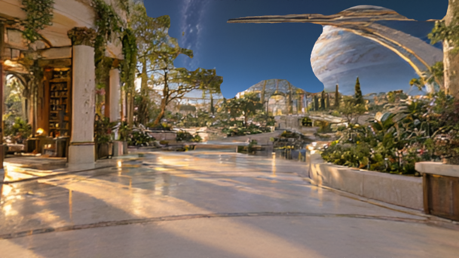
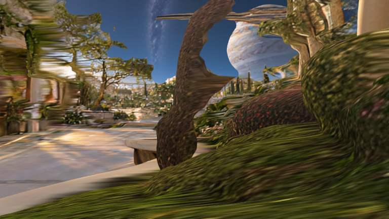

# Orbital garden reconstruction trial — 6 October 2026

A separate scene-scale experiment using an original built-in image-generation reference and FAL's Hunyuan World pipeline. This is not a screenshot of the running Permagent app and has not replaced the live habitat.

The original reference and exact image prompt are under `references/`. `panorama-job.json` preserves the panorama prompt, input and completed request ID; `panorama.png` is the locally verified 1920×960 output. `world-job.json` preserves the submitted panorama-to-mesh request and labels. Estimated FAL cost: $0.15 panorama + $0.30 reconstruction = **$0.45**, separate from $2.625 in object trials. Total across both folders is $3.075 estimated, not a billing balance.

## Completed acquisition and review

Both jobs completed, downloaded and registered in the FAL library. The world archive is **365,188,753 bytes**, SHA256 `f865b9d6d100a2d1e25a52425b7308329bfbfdb918ca73e67ba420a822dbf5ad`. Its three vertex-colored PLY layers contain **7,910,122 vertices and 15,950,359 triangles**. Exact archive and extracted-file checksums are recorded. The official process is [image/text to panorama](https://fal.ai/models/fal-ai/hunyuan_world/api), then [panorama to layered scene geometry](https://fal.ai/models/fal-ai/hunyuan_world/image-to-world/api); see the [upstream implementation](https://github.com/Tencent-Hunyuan/HunyuanWorld-1.0).

`download_world.py` uses the same verified-HTTPS/request-local DNS recovery as the successful object downloads. It accepts completed result receipts, checks size/magic/checksum, enforces a bounded transfer budget and retains a 10 GiB free-disk floor. It never submits jobs or disables certificate verification. An archive member listing is saved without automatically executing or extracting downloaded content.

```sh
python3 assets/world/fal-world-trial-20261006/download_world.py panorama
python3 assets/world/fal-world-trial-20261006/download_world.py world
```

Original archive, unpacked data and diagnostic mesh subsets are locally preserved but gitignored to avoid large duplicate Git storage. The provider returned a signed Google Cloud Storage link; its query is kept only in a mode-0600 ignored private receipt and omitted from committed ledgers. The helper accepts that specific FAL storage bucket and passes the URL through stdin. If it expires, preserve the local archive and recover the existing job rather than generating again. Reference, panorama, exact prompts, receipts and review evidence are committed. URLs may expire; recover an existing library asset or result before spending on another generation.

## Decision: retain as reference; hold from runtime

The panorama preserves a coherent broad garden, but vegetation and fine architecture are softer than the original reference. The actual reconstructed geometry has visible sky/architecture cutouts even at the original viewpoint. Moving one provider unit sideways produces stretched vegetation, warped columns, broken arch surfaces and exposed foreground artifacts. Provider units have not been calibrated to metres. This result is useful as a composition/material reference; it is not accepted as a replacement for the walkable live habitat.

The geometry is also far above the current asset budget. It has baked vertex colors, not the furniture's reusable PBR texture workflow. Collision, floor calibration, navigation, complete free movement, relighting and native rendering performance remain unverified. No live agent, voice or navigation system was replaced.

| Original camera | One-unit sideways move |
| --- | --- |
|  |  |

These are offline renders of the downloaded geometry, not generated illustrations or app screenshots. `prepare_diagnostic.py` conservatively selects the original triangles intersecting the two fixed camera frusta, preserving their shape and RGB values (float64 positions become float32). It reads binary PLY in bounded NumPy chunks, avoiding a full 16-million-triangle Blender import. The resulting 1,063,665 diagnostic triangles were rendered with unlit vertex colors, 75° horizontal FOV, four CPU samples, one thread, 768×432 output. The render completed in 10.1 seconds under a 3 GiB resident-memory cap, 180 s watchdog and 10 GiB disk floor. This is visual evidence, not a native FPS benchmark. Camera orientation follows the [upstream viewer](https://github.com/Tencent-Hunyuan/HunyuanWorld-1.0/blob/main/modelviewer.html).

To reproduce using existing Blender 5.2's bundled Python:

```sh
python3 assets/world/fal-world-trial-20261006/inspect_archive.py
/Applications/Blender.app/Contents/Resources/5.2/python/bin/python3.13 assets/world/fal-world-trial-20261006/prepare_diagnostic.py
/Applications/Blender.app/Contents/MacOS/Blender --background --factory-startup --python-exit-code 1 --python assets/world/fal-world-trial-20261006/render_world.py
```

The inspection helper extracts only bounded mesh/image data after validating archive paths and sizes. It never runs provider code. `mesh-inspection.json` records original counts/bounds, diagnostic counts, viewpoint coordinates and limitations. The accepted furniture is documented in `../fal-trial-20261006/README.md`.
