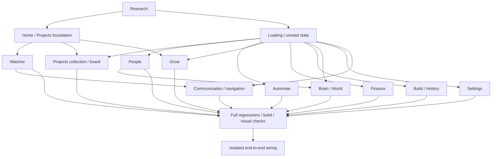

# UX implementation DAG

The executable inventory is [dag.json](dag.json). Each node contains dependencies, acceptance checks, status and evidence. `verified` requires acceptance evidence, not just source changes. D01 retains the earlier Home/Projects baseline while actual daemon wiring is checked.

Tests must exercise outcomes: retained drafts, exact navigation targets, no unintended writes, stale-response rejection, truthful error states and preservation of unrelated records. Source-string assertions alone do not verify a working route. Existing live data is never a mutable test fixture.

Run `python3 reports/ux-dag/check_dag.py` to validate dependency and evidence integrity. Add `--complete` for a gate that fails until every node is verified. Implementation and verification status are separate in the inventory. See [verification.md](verification.md) for page contracts, test commands, recorded results, rendered review and remaining boundaries.
