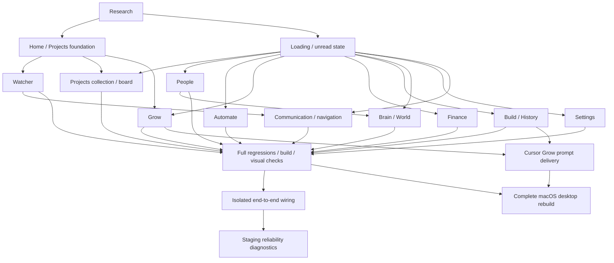

# UX implementation DAG

The executable inventory is [dag.json](dag.json). Each node contains dependencies, acceptance checks, status and evidence. `verified` requires acceptance evidence, not just source changes. D01 retains the earlier Home/Projects baseline while actual daemon wiring is checked.



Tests must exercise outcomes: retained drafts, exact navigation targets, no unintended writes, stale-response rejection, truthful error states and preservation of unrelated records. Source-string assertions alone do not verify a working route. Existing live data is never a mutable test fixture.


Run `python3 reports/ux-dag/check_dag.py` to validate dependency and evidence integrity. Add `--complete` for a gate that fails until every node is verified. Implementation and verification status are separate in the inventory. See [verification.md](verification.md) for page contracts, test commands, recorded results, rendered review and remaining boundaries.

## Independent staging probe

For a repeat-run diagnostic, start `run_rust_tests.py --browser` through the external guard and wait for its ready message. Then run:

```sh
python3 reports/ux-dag/probe_staging.py <printed-private-directory> --seconds 240
```

The separate client polls six real API surfaces on **3002 only**, with a three-second socket timeout. It validates the fixture identities, then checks project/person edits and creates `finish` only after success; the daemon test independently verifies persistence. This is sustained HTTP evidence, not browser interaction evidence. No UI or production code is changed by the probe.

A failed probe leaves `finish` absent and exits nonzero. Inspect the failure and stop only the exact owned staging guard if the daemon remains unresponsive; do not leave it running or mark acceptance complete manually. The existing external one-hour guard remains in force. The browser test's internal timeout cannot substitute for the independent client when its async runtime stalls.

## Full desktop rebuild

`rebuild_desktop.py` runs the backend, stage, app and verify phases sequentially. Native compilation and staging use the existing external guard; no phase installs or launches the live app. Commit product sources before packaging. The backend and UI/Tauri source revisions are recorded separately so documentation/UI changes do not silently invalidate or mislabel a Rust artifact.

A completed external Cargo JSON log may be imported with `backend --cargo-log <exact-log> --source-head <build-start-revision>`. Its adjacent guard receipt must pass. The stage phase checks pinned resources; app builds the frontend and complete Tauri bundle; verify checks signatures, code sections, resources and source provenance. The generated `desktop-rebuild-manifest.json` records the exact deliverable. D17 remains open until those checks succeed.
